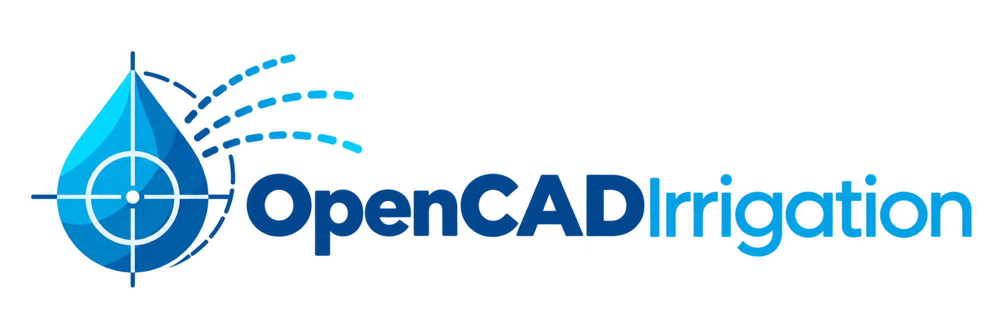

<p align="center"></p>

<p align="center"><a href="https://opencadirrigation.com">opencadirrigation.com</a> · <a href="https://opencadirrigation.com/pt/">Português</a> · <a href="https://opencadirrigation.com/es/">Español</a></p>

<p align="center"><strong>English</strong> · <a href="README.pt-BR.md">Português</a></p>

# OpenCADIrrigation

Open CAD, written in Flutter/Dart, for the design of pressurised irrigation systems: drawing,
hydraulic network, pipe sizing, reports and plotting, right in the browser, with no installation,
no server and no sign-up. Projects stay on your computer.

> This README is the canonical documentation, maintained in English; a Portuguese translation is
> in [README.pt-BR.md](README.pt-BR.md). The technical study behind the engine is in
> [docs/TECHNICAL_STUDY.md](docs/TECHNICAL_STUDY.md) (English) and
> [docs/PESQUISA.pt-BR.md](docs/PESQUISA.pt-BR.md) (Portuguese). The interface is available in
> Portuguese, English and Spanish.

---

## Contents

1. [Overview](#1-overview)
2. [Five-minute start](#2-five-minute-start)
3. [Design workflow](#3-design-workflow)
4. [Interface](#4-interface)
5. [Drawing and editing](#5-drawing-and-editing)
6. [Hydraulic network](#6-hydraulic-network)
7. [Component catalogue](#7-component-catalogue)
8. [Terrain](#8-terrain)
9. [Calculation and sizing](#9-calculation-and-sizing)
10. [Reports, plotting and export](#10-reports-plotting-and-export)
11. [File formats](#11-file-formats)
12. [Storage, privacy and network access](#12-storage-privacy-and-network-access)
13. [Languages and site](#13-languages-and-site)
14. [Code architecture](#14-code-architecture)
15. [Development](#15-development)
16. [Tests](#16-tests)
17. [Known limitations and roadmap](#17-known-limitations-and-roadmap)
18. [Contributing](#18-contributing)
19. [References](#19-references)

---

## 1. Overview

### What it is

A single application covering the whole cycle of a pressurised irrigation design:

- **2D CAD drawing** with layers, snaps, dimensions, hatches, symbols and AutoCAD-style
  command aliases.
- **Hydraulic network** drawn on top of the CAD: water supplies, pumps, mainline, zone valves,
  laterals with emitters, drip tapes and driplines, filters, regulators, meters, junctions and
  centre pivots.
- **Hydraulic engine** in pure Dart: Hazen-Williams or Darcy-Weisbach friction, minor losses,
  emitters `q = k·H^x`, network solver by the Global Gradient Algorithm (the one used by EPANET),
  pumps, pressure-reducing valves, water hammer, tape flushing.
- **Automatic sizing** of laterals, submains and mainline by linear programming (annualised pipe
  cost plus energy, emitter pressure window, pipe pressure rating, telescoping) or by the classic
  maximum-velocity method.
- **Terrain**: contour lines, spot heights, digital terrain model by triangulation, elevation
  downloaded from the internet for a coordinate, profiles and hydraulic grade line.
- **Outputs**: reports of zones, pipes, emitters, system flows, bill of materials with fittings,
  water requirements and controller programme; PDF sheet; DXF, DWG, SVG, KML, KMZ, GeoJSON,
  Excel, CSV.
- **Open manufacturer catalogues** in JSON, loadable by file or URL.

### Who it is for

Agricultural and landscape irrigation designers, agronomists, engineers, dealers, teachers and
students. The interactive tutorial and the example gallery let you start without reading a manual.

### Principles

| Principle | What it means in practice |
|---|---|
| Open | Code, project format (`.oci.json`), catalogues (`.oci.cat`) and examples are readable files, documented in this repository. |
| In the browser | Chrome, Edge, Firefox and Safari, on desktop, tablet and phone; installable as a PWA. It also builds for desktop (macOS, Windows, Linux). |
| No server | Nothing is sent anywhere. Projects live in the browser and in local files. Only online elevation and base maps touch the internet, and only when asked. |
| Transparent engine | Every formula is documented in the code and in the [technical study](docs/TECHNICAL_STUDY.md), with tests comparing it to reference values. |
| 20 languages | Interface in Portuguese, English, Spanish, Chinese, Hindi, Arabic, French, Bengali, Russian, Urdu, Indonesian, German, Japanese, Marathi, Vietnamese, Telugu, Hausa, Turkish, Punjabi and Swahili; the app opens in the system language. |

---

## 2. Five-minute start

1. Open [opencadirrigation.com](https://opencadirrigation.com). On the first visit the welcome
   screen shows the **example gallery** and the **interactive tutorial** button.
2. Pick an example (the orchard is the default) or start from scratch.
3. Press **F5** (or the ▶ button at the top right). The calculation runs off the interface thread;
   a progress card shows the current step (zone by zone, mainline, flushing, water hammer,
   materials). The screen stays usable while it runs.
4. Read the results in the **Reports** panel (F2): zone summary, pipes with diameters and
   pressures, emitters, mainline and supply duties, bill of materials, water requirements,
   hydraulic grade line, messages.
5. Hover a pipe to see diameter, flow, velocity and head loss; select a lateral and open the
   **Hydraulic grade line** tab; switch the drawing overlay in View (velocity, pressure, diameters,
   minimum and maximum pressure).
6. Export: File → Export drawing (PDF with sheet, DXF, DWG…) or Export report (PDF, Excel, CSV,
   TXT). Save the project with **Ctrl+S** (`.oci.json`).

### Example gallery

| id | Project | Contents | Zones |
|---|---|---|---|
| `orchard` | Orchard | Micro-sprinklers on citrus and drip on grapes, well, pump and filter, sloping ground | 2 |
| `garden` | Residential garden | Pop-up sprays on the front lawn, rotors at the back, drip in the beds; mains supply with meter and backflow preventer | 3 |
| `sportsField` | Football pitch | 105 × 68 m, impact sprinklers in five rows, reservoir, pump, night-time shifts | 5 |
| `rowCrop` | Drip row crop | Four tomato blocks on tape, submains with valves, screen filter, pump, 1 % slope | 4 |
| `pivot` | Centre pivot | 300 m pivot on maize, mainline, well and pump; tower, span and nozzle report | 1 pivot |
| `greenhouse` | Vegetable greenhouse | Four pepper tunnels on pressure-compensating dripline, tank, small pump and disc filter | 4 |
| `nursery` | Plant nursery | Three beds under overhead micro-sprinklers on a 4 × 4 m grid, elevated tank, small pump and disc filter | 3 |
| `coffee` | Coffee on contour lines | Three hillside blocks with curved laterals following the contours (guided block), PC dripline, well and pump | 3 |
| `bananas` | Banana plantation | Two blocks under pressure-compensating micro-sprinklers at 5 × 5 m, well with submersible pump and disc filter | 2 |
| `sugarcane` | Subsurface drip sugarcane | 20 mm PC dripline buried 0.3 m deep, 180 m laterals, buried submains, screen filter and air valve | 2 |
| `gravity` | Gravity-fed drip | Reservoir 40 m above the blocks, no pump: gate valve, pressure-reducing valve and filter on the mainline | 2 |
| `pasture` | Sprinkler-irrigated pasture | Three paddocks with impact-sprinkler lines at 12 × 18 m, reservoir, pump and check valve | 3 |
| `golf` | Golf hole | Tee with sprays, fairway with rotors on a triangular grid and green with rotors around the edge, pond and pump | 4 |
| `sectorPivot` | Sector pivot with end gun | 250 m pivot sweeping 270° with a 12 m³/h end gun, pond, 30 hp pump and gate valve | 1 pivot |
| `linear` | Linear move | 392 m lateral-move machine travelling 800 m along a canal, intake with a 30 hp pump | 1 linear |

Examples open from the welcome screen (Help → Welcome and example gallery…), from the File →
Examples menu and from the URL. The same projects are in [examples/](examples/) as `.oci.json`
files, one folder per interface language (`examples/de/`, `examples/ja/`, … 20 in all): the same
drawing everywhere, with the names, crops and catalogue items in that language.

### URL parameters

| Parameter | Effect |
|---|---|
| `?example=garden` | Opens the given example (`orchard`, `garden`, `sportsField`, `rowCrop`, `pivot`, `greenhouse`, `nursery`, `coffee`, `bananas`, `sugarcane`, `gravity`, `pasture`, `golf`, `sectorPivot`, `linear`). |
| `?design=1` | Designs on load. |
| `?tutorial=N` | Opens the interactive tutorial at step N. |
| `?lang=pt` (any code of section 13) | Language for this visit (does not change the saved preference). |
| `/pt/`, `/es/`, `/de/`, … | Entry page of each language under its code (all 20), with the same effect as `?lang` (the root page is the English one). |

---

## 3. Design workflow

The workflow follows established irrigation design practice (inventory and terrain, layout, zones,
management, mainline, materials and plotting), adapted to a browser app.

1. **Project details** (File → Details): name, client, site, designer and notes, which go to the
   sheet title block and the reports. Units (metric or US) in Tools → Units.
2. **Background information**: import the base (DXF, DWG, KML/KMZ, SHP, survey CSV, GeoTIFF,
   satellite image) or draw boundaries, buildings and roads. Images out of scale are fitted with
   Align by 2 points (AL). Georeference the project (File → Georeference) when you want base maps,
   online elevation or KML/GeoJSON export.
3. **Terrain**: draw contour lines (CT) and spot heights (SP), import a survey or an elevation
   GeoTIFF, or download the elevation from the internet for a coordinate. Generate contours from
   the model and check them in 3D.
4. **Hydraulic layout**: water supply (WS), pump (PU), mainline (MP), zone valves (V) and, downstream
   of each valve, zone pipes (ZP), laterals (SL), tapes (DT), emitters (OUT), devices (F). The
   **lateral block** (B) and **sprinkler grid** (AH) generators do the repetitive work. Irrigated
   areas (AR) carry crop, efficiency and water balance.
5. **Management** (Project → Management): system flows (which valves open together, start time and
   duration). Without defined flows, every valve is its own flow.
6. **Check** (Project → Check design): unconnected items, pipes crossing without a junction, dead
   ends, zones without emitters, missing catalogue items, missing terrain.
7. **Design** (F5): zones, mainline, telescoping, flushing, water hammer and materials. You can
   also design only the zones, only the mainline, or just analyse with the current diameters.
8. **Reports and plotting**: reports panel, PDF sheet with title block, legend, north arrow,
   scale bar and bill of materials; exports to other CADs, GIS and spreadsheets.

---

## 4. Interface

### Layout (wide screen)

- **Menu bar** at the top; on the right, the ▶ Design and Save buttons (amber when there are
  unsaved changes).
- **Project tabs** just below: several projects open at once (Ctrl+Alt+N new tab, Ctrl+Alt+W
  close, Ctrl+Alt+←/→ switch). Copy and paste (Ctrl+C/X/V) work across tabs and across browser
  windows, carrying layers and catalogue items missing at the destination.
- **Tool palette** on the left, by group (navigation, drawing, terrain, zone, mainline, editing).
- **Canvas** in the centre, with grid, snaps, overlays and the calculation progress card.
- **Side panel** on the right with three tabs: **Properties** of the selected item (with hydraulic
  results after the calculation and the submain position envelope for laterals), **Layers**
  (visibility, lock, colour, rename, create, remove) and **History** (a timeline of states, as in
  Photoshop: click to go back or forward).
- **Reports** below the canvas (F2), resizable.
- **Status bar** with cursor coordinates, active snap, typed command, tool hint, toggles (snap,
  ortho, grid) and the app version.

### Compact layout (phone and tablet)

Below 700 px of width the screen changes: ☰ menu at the top, tool bar by group at the bottom,
Done/Cancel buttons instead of Enter/Esc, properties and reports in sliding panels. Pinch to
zoom, two fingers to pan, one finger draws.

### Menus

| Menu | Items |
|---|---|
| File | New project, New tab, Close tab, Open project, Recent projects, Save, Versions, Autosave (on/off), Examples ▸, Import (DXF, DWG, KML/KMZ, SHP, CSV/XYZ, images, GeoTIFF), Georeference selected image, Align by 2 points, Export drawing ▸ (DXF, DWG, PDF, SVG, KML, KMZ, GeoJSON), Export report ▸ (CSV, TXT, XLSX, PDF, controller programme), Project details, Georeference |
| Edit | Undo, Redo, Select all, Copy, Cut, Paste, Duplicate, Delete, Transform ▸ (rotate, mirror, scale, offset, trim, extend, cut pipe, align image, array) |
| View | Zoom extents, Zoom +/−, Grid, Labels, Wetted radii, Grips, Overlay (none, velocity, pressure, diameters, pressure min/max), Base map ▸ (none, OpenStreetMap, OpenTopoMap, CARTO, Esri imagery/streets/topo, Google Maps roadmap/satellite/hybrid/terrain with your own API key, custom XYZ URL; needs a georeference), Google Maps API key…, Custom map URL…, Language ▸ |
| Draw | Line, Polyline, Rectangle, Circle, Arc, Spline, Hatch, Symbol, Text, Linear dimension, Angular dimension, Radial dimension, Leader, Measure |
| Zone | Zone pipe, Lateral (sprayline), Drip tape, Emitter, Zone valve, Device, Junction, Lateral block, Sprinkler grid, Submain position envelope |
| Mainline | Water supply, Mainline pipe, Pump, Pump selection, Centre pivot / linear move |
| Project | Design parameters, Component catalogue, Management (system flows), Terrain ▸ (contour line, spot height, profile, download elevation from the internet, generate contours from the model, 3D view, clear profile), Check design, Design zones, Design mainline, Design all, Analyse (no resizing), Clear results |
| Reports | Show/hide the panel and its tabs |
| Tools | Lateral calculator, Pump and system curve, Water hammer, Units |
| Help | Interactive tutorial, Welcome and example gallery, Keyboard shortcuts, About |

### Keyboard shortcuts

With the drawing focused, type the alias and **Enter** or **Space**; a complete alias also runs by
itself after a pause. Aliases accept Portuguese, English and Spanish names (for example `LINHA`,
`LINE`, `LINEA`). The full list is in Help → Keyboard shortcuts.

| Group | Aliases |
|---|---|
| Navigation | `S` select · `P` pan · `Z` / `ZE` zoom extents · `ZI` / `ZO` zoom |
| Drawing | `L` line · `PL` polyline · `REC` rectangle · `C` circle · `A` arc · `SPL` spline · `H` hatch · `SY` / `I` symbol · `T` / `MT` text · `D` dimension · `DAN` angular dimension · `DRA` radial dimension · `LE` leader · `ME` / `DI` measure |
| Terrain | `CT` contour line · `SP` spot height · `PR` profile · `AR` irrigated area |
| Editing | `RO` rotate · `MI` mirror · `SC` scale · `O` offset · `TR` trim · `EX` extend · `CUT` / `BR` cut pipe · `ARRAY` array · `E` erase · `CO` copy · `PA` paste · `U` undo · `REDO` · `ALL` select all · `DUP` duplicate · `AL` align by 2 points |
| Zone | `ZP` zone pipe · `SL` lateral · `DT` tape · `OUT` / `EM` emitter · `V` valve · `F` device · `J` junction · `B` block · `AH` sprinkler grid · `FE` submain envelope |
| Mainline | `MP` mainline pipe · `WS` supply · `PU` pump · `PV` pivot |
| Design and files | `RUN` design · `CHK` check · `REP` reports · `SAVE` · `OPEN` · `OS` snap · `OR` ortho · `GS` grid snap · `GR` grid |

| Key | Action |
|---|---|
| F2 | Show/hide reports |
| F3 | Toggle object snap |
| F5 | Design all |
| F7 | Grid |
| F8 | Ortho |
| F9 | Grid snap |
| Home | Zoom extents |
| Enter | Finishes the polyline/lateral being drawn; when selecting, repeats the last tool |
| Esc | Cancels the tool or clears the selection |
| Del | Deletes the selection |
| Shift (held) | Locks the segment to 0°, 45°, 90° |
| Ctrl+Z / Ctrl+Y | Undo / redo |
| Ctrl+A, Ctrl+D | Select all, duplicate |
| Ctrl+C / X / V | Copy, cut, paste (also across tabs and windows) |
| Ctrl+S, Ctrl+O, Ctrl+I | Save, open, import |
| Ctrl+Alt+N / W / ← / → | New tab, close tab, switch tabs |

Shortcuts are captured natively (window keyboard listener in the browser, `HardwareKeyboard` on
desktop) and work whatever widget has the focus, except while a menu or a dialog is open.

---

## 5. Drawing and editing

### Drawing entities

Line, polyline (open or closed), rectangle, circle, arc, spline (smooth curve through the points),
hatch (lines or solid), symbol (north arrow, tree, building, tank, well, valve box, pump house,
gate, filter station), text, linear, angular and radial dimensions, leader, image (georeferenced
raster or placed by hand), contour line, spot height and irrigated area.

### Snaps

Endpoints, midpoints, hydraulic nodes, "on" pipes and laterals (the nearest point of the segment),
circle perimeters, grid, ortho and 45° lock with Shift. The tolerance is in pixels, so it does not
depend on the zoom. The marker changes shape with the snap type.

### Selection and grips

Click selects; Shift+click toggles; a window dragged left to right selects what lies entirely
inside it and right to left what it crosses (AutoCAD convention). Up to 12 selected entities show
**grips**: drag a vertex to move it, drag the midpoint of a segment to insert a vertex, Ctrl+click a
vertex to remove it.

### Transformations

Move (drag), rotate, mirror (keeping the original or not), scale, offset, trim and extend against
the selected or visible entities, cut pipes, rectangular or polar array and alignment by two
points (moves, rotates and scales an image or an imported drawing in one go). Inserting a valve,
junction, pump or device on a pipe splits the pipe at that point.

### Layers

Every entity type is born on its default layer (DRAWING, TEXT, DIMENSIONS, CONTOURS,
SPOT_HEIGHTS, ZONE_PIPES, MAINLINE_PIPES, SPRAYLINES, TAPES, OUTLETS, WETTED_RADII,
CONTROL_VALVES, WATER_SUPPLY, PUMPS, MISC_HYDRAULIC, JUNCTIONS, AREAS, LABELS, IMAGES, HATCHES,
SYMBOLS, PIVOTS). Layers imported from DXF/DWG/KML are preserved. A layer can be hidden (leaves
the drawing, the snap and the selection) or locked (visible but not editable).

### History

Every action produces a named state (add line, move 3 items, design, import…). Undo and redo walk
up to 50 states; the History panel jumps to any of them.

---

## 6. Hydraulic network

### Hydraulic entities

| Entity | Alias | Layer | Role in the calculation |
|---|---|---|---|
| Water supply | `WS` | WATER_SUPPLY | Origin of the mainline. Calculated pressure (well with a negative water level, reservoir with a positive height) or fixed (mains with design and maximum pressure and flow). |
| Pump | `PU` | PUMPS | Catalogue H(Q) curve, with speed ratio; operating point in the system-flow analysis. |
| Mainline pipe | `MP` | MAINLINE_PIPES | From the supply to the valves; fixed diameter or sized (`computerSized`). |
| Zone valve | `V` | CONTROL_VALVES | Separates mainline and zone; names the zone; may have a fixed downstream pressure for a detailed analysis. |
| Zone pipe | `ZP` | ZONE_PIPES | Submains and distributors downstream of the valve. |
| Lateral (sprayline) | `SL` | SPRAYLINES | Pipe with equally spaced emitters: emitter and nozzle from the catalogue, spacing, first-outlet offset, arc, riser height, depth. |
| Tape / dripline | `DT` | TAPES | Integral emitters defined by the catalogue item; inlet pressure, regulated or not, flushing flow. |
| Single emitter | `OUT` | OUTLETS | Sprinkler, micro-sprinkler, dripper, gun or demand point on a zone pipe (or on the mainline, as its own zone). |
| Device | `F` | MISC_HYDRAULIC | Gate valve, filter, pressure regulator (with setting), meter, backflow preventer, air valve, check valve; in a zone or on the mainline. |
| Junction | `J` | JUNCTIONS | Explicit node, with optional fixed elevation. |
| Irrigated area | `AR` | AREAS | Polygon with crop, net depth or water balance (ETo, Kc, available water, root depth, allowable depletion), efficiency, wetted fraction, emitters per plant. |
| Centre pivot / linear move | `PV` | PIVOTS | Machine with radius, spans, applied depth, cycle, end pressure, end gun, cost. A demand on the mainline. |

### Connection rules

- **Coincident vertices connect.** Two pipes sharing a vertex (within the connection tolerance,
  0.05 m by default) form a node. A pipe ending in the middle of another is joined by an automatic
  tee. Emitters, valves, pumps and devices placed on a pipe split it.
- **The valve separates the worlds.** Everything downstream of a zone valve belongs to that zone;
  the mainline runs from the supply to the valves. Zone items do not connect to mainline items
  without a valve between them.
- **Tapes and laterals must not touch across zones.** Since coincident vertices connect, the ends
  of tapes in neighbouring blocks must stay apart (a service strip between blocks), or the two
  zones will be calculated as one. The design check warns about unconnected items, pipes crossing
  without a junction and dead ends.
- **Laterals are lumped.** In the graph each lateral becomes a sequence of nodes with aggregated
  emitters (up to 100 nodes per lateral by default, adjustable), which keeps the calculation fast
  even with hundreds of emitters per line.

### Generators

- **Lateral block** (B): polygon, direction, lateral spacing, offset of the first one, lateral with
  emitters or tape, submain position (start, centre, end), valve (position and model), valve stub
  length, names. If a line, polyline, contour line or spline is selected when the dialog opens it
  can act as a guide: the laterals follow the curve (parallel to a contour line or a curved
  boundary) and are clipped by the polygon.
- **Sprinkler grid** (AH): polygon, sprinkler and nozzle, spacings, square or triangular pattern,
  direction and design pressure.
- **Submain position envelope** (FE): for every selected lateral, paints in green the stretch where
  the submain can feed it while keeping the pressure window, taking the terrain into account.

---

## 7. Component catalogue

The project catalogue has six groups: **pipes**, **emitters** (with nozzles), **tapes**, **valves
and devices**, **pumps** and **fittings**. All internal hydraulic values are in SI.

| Group | Main fields |
|---|---|
| Pipes | DN, inner diameter, material, Hazen-Williams C, roughness, pressure rating, usage (lateral, zone, mainline), cost per metre, supplier, code |
| Emitters and nozzles | Kind (sprinkler, micro-sprinkler, dripper, bubbler, gun, demand point), curve `q = k·H^x`, wetted radius `R = a·H^b`, arc, default, minimum and maximum pressure, manufacturing CV, flow tolerance, inlet diameter, riser height, cost |
| Tapes | Inner diameter, emitter spacing and curve, barb coefficient, CV, default, minimum and maximum inlet pressure, tolerances above and below, rating, cost per metre |
| Valves and devices | Kind (zone, PRV, gate, check, backflow, filter, meter, air valve, other), diameter, loss `h = K·Q^n + C`, minimum and maximum flow, default PRV setting, cost |
| Pumps | (Q, H) points fitted to a parabola, efficiency, power, maximum flow, cost |
| Fittings | Kind (coupler, 90° and 45° elbow, tee, cross, reducer, end cap, adapter, lateral take-off, tape end, riser), diameters, cost |

The **default catalogue** ships 17 pipes (PE 16–50 mm, PVC DN 35–250, HDPE 110 and 160, 6" steel),
9 emitter families (PC and turbulent drippers, micro-sprinklers, impact sprinkler, gun, garden rotor
and spray, demand point), 6 tapes and driplines, 30 valves and devices (1" to 6"), 17 pumps
(centrifugal 1 to 100 hp, submersible 3 to 25 hp) and about 330 fittings generated for every
nominal diameter (couplers, 90° and 45° elbows, tees, crosses, end caps, adapters and reducers, plus lateral take-offs, tape ends and risers), with translated names and
illustrative prices.

The editor (Project → Component catalogue) edits, duplicates and removes items, imports and exports
JSON, CSV per group and **Excel** (export, fill in prices in the spreadsheet and import it back), sets
the default catalogue for new projects and restores the original.

### Manufacturer catalogues (`.oci.cat`)

Nine packs ship with the app: Netafim, Rivulis, Jain, Toro, Rain Bird, Nelson, Hunter, NaanDanJain
and Senninger, with representative products and typical catalogue data (75 items). They live in
[catalogs/](catalogs/) as JSON files, one per manufacturer, plus an `index.json`. Through the
*Manufacturer catalogues…* dialog you add a pack to the project, import an `.oci.cat` file or load a
pack or a whole index by URL, which lets any dealer or community keep its own repository. The project
catalogue is exported in the same format. The complete format, with the fields of every group and the
contribution rules, is in [catalogs/README.md](catalogs/README.md); `dart run tool/gen_catalogs.dart`
validates the packs (unique ids, plausible curves) and rebuilds the index.

---

## 8. Terrain

- **Elevation sources**: drawn contour lines (with automatic increment and optional smoothing),
  spot heights (the elevation is asked at every click), survey points (CSV, TXT, XYZ, PNEZD),
  DXF/DWG with elevation (polylines on contour layers or with an elevation), KML with altitude,
  shapefile with Z or an elevation attribute, elevation GeoTIFF (single-band raster) and
  **online elevation**.
- **Digital terrain model**: Delaunay triangulation (TIN) with linear interpolation inside the
  triangles, exact on planar slopes, and inverse-distance interpolation as an alternative and as a
  complement outside the convex hull. Contour lines are sampled every 5 m (adjustable). Surveys with
  more than 12 thousand points are decimated for the triangulation.
- **Online elevation** (Project → Terrain → Download elevation from the internet): a grid of points
  over the project or over the visible area is queried from free public services with no key:
  Open-Meteo (Copernicus GLO-90) and OpenTopoData (SRTM 30 m, ASTER 30 m). In an empty project you
  can just paste the coordinate of the site (decimal, Google Maps link or degrees/minutes/seconds):
  the drawing origin moves there and the elevation is downloaded in a square around it. When it
  finishes, contour lines can be generated automatically with an interval chosen from the relief.
- **Tools**: generate contour lines from the model (derived curves that do not feed the model back),
  3D view of the terrain with the pipes draped on it, profile along a path (with the pipe and the
  hydraulic grade line when there are results); the pressure of every emitter accounts for the
  ground elevation plus the riser height minus the burial depth.

---

## 9. Calculation and sizing

### Design parameters (Project → Parameters)

| Group | Parameters and defaults |
|---|---|
| Hydraulics | Friction formula: Hazen-Williams (default) or Darcy-Weisbach; water temperature 20 °C (viscosity computed); minor losses 5 % of the length, enabled; C scale and offset (ageing); connection tolerance 0.05 m; at most 100 lumped nodes per lateral |
| Maximum velocities | 2.0 m/s in laterals, 1.5 m/s in zone pipes, 2.0 m/s in the mainline |
| Sizing | LP method (default) or velocity + pressure window (greedy); diameters per lateral (1), per submain (3) and per mainline (3); maximum pressure variation in the zone (0 = derived from the emitter flow tolerance); emitters per plant (1) |
| Economics | Interest 10 %, term 10 years, energy 0.75 per kWh, pump efficiency 65 %, 2000 h/year for the mainline and 500 h/year per zone, capital × energy trade-off enabled, currency R$ |
| Flushing and safety | Tape flushing velocity 0.3 m/s with 1 m minimum pressure at the open end; water hammer check enabled with valve closure time (0 = instantaneous) |
| Materials | Automatic fitting selection enabled; 6 m pipe sticks to count couplers |
| Terrain | Triangulation (default) or inverse-distance interpolation; contour densification 5 m |

### Calculation steps

1. **Graph construction**: entities → nodes and links; coincident vertices merged; point items
   inserted into pipes; laterals lumped; terrain elevation at every node; zones identified from
   every valve.
2. **Zones**, one by one:
   - initial sizing by maximum velocity, which also provides the nominal flows;
   - **LP**: every sizable unit may be built from fractions of the candidate diameters; the linear
     programme minimises the annualised pipe cost plus the energy cost of the inlet pressure,
     subject to the pressure window of the critical emitters (the end, the highest and the lowest
     point of every lateral, every single emitter). If the analysis does not confirm the window, the
     emitters at minimum and maximum pressure become constraints and the LP runs again (up to four
     rounds);
   - **repair**: greedy diameter increase along the critical path until the window is met;
   - **rationalisation**: non-increasing diameters from upstream to downstream and telescoping
     within the limit of diameters per unit;
   - **detailed analysis**: non-linear network with pressure-dependent emitters; the pressure
     downstream of the valve is chosen by bisection so that the mean emitter pressure equals the
     nominal one (or, for regulated tapes, to guarantee the minimum submain pressure);
   - results: zone flow, minimum and maximum pressures and the allowable ones, allowable and actual
     variation, required valve pressure, valve loss, uniformity (Christiansen CU, low-quarter DU,
     Keller-Karmeli EU with the manufacturer CV and emitters per plant, statistical uniformity, flow
     variation), overlap CU for sprinklers with a wetted radius, pipe table with pressures,
     elevations and velocities, emitter table.
3. **Mainline**, per system flow: demand and required pressure of every valve and pivot, LP over all
   flows with the energy cost weighted by the hours of each, analysis of every flow with pumps
   (operating point), PRVs, check valves and fixed- or calculated-pressure supplies; duty of every
   supply (flow, available pressure, required pressure, deficit) and annual energy.
4. **Telescoping**: pipes with more than one diameter are split into entities, largest diameter
   upstream, and the affected zones are re-analysed.
5. **Flushing**: every zone with tapes is analysed with the ends open at the flushing velocity;
   reports the flushing flow, the required valve and upstream pressure, number of tapes, minimum end
   pressure and maximum velocity.
6. **Water hammer**: for the worst segment of every pipe, wave celerity from material and wall,
   Joukowsky surge for the operating velocity, critical time 2L/a and comparison of the maximum
   static pressure plus surge with the pipe rating, taking the closure time into account.
7. **Materials**: pipes by diameter and rating, emitters, tapes, valves, devices, pumps (with
   automatic selection from the catalogue and a standard IEC motor), pivots with towers, sprinklers
   and regulators, and **fittings selected automatically** from the geometry (couplers per stick,
   elbows, tees, crosses, reducers, end caps, lateral take-offs, tape ends, risers), with costs,
   annualised cost (capital recovery factor) and energy.

The calculation runs in a **Web Worker** in the browser (or in an isolate on desktop) and returns
the resized entities and the results to the interface; while it runs, editing is blocked so that
no change is lost, but navigation, reports and other tabs stay free.

### Design check

| Code | Severity | Meaning |
|---|---|---|
| `unconnected` | error | Hydraulic item not connected to the network |
| `no_supply` | error | No water supply |
| `no_valves` | error | No zone valve (nor pivot) |
| `zone_no_emitters` | error | Valve without emitters downstream |
| `spec_missing` | error | Item references a component that is not in the catalogue |
| `zero_length` | error | Zero-length pipe |
| `pivot_unconnected` | error | Pivot away from a mainline node |
| `pipes_cross` | warning | Pipes crossing without a junction |
| `mainline_dead_end` | warning | Dead end on the mainline |
| `duplicate_item`, `duplicate_zone_name` | warning | Overlapping items; zones with the same name |
| `tiny_segment` | warning | Segment shorter than the tolerance |
| `supply_no_head` | warning | Fixed-pressure supply without a pressure |
| `zone_dead_end`, `area_no_emitters`, `no_terrain`, `looped_mainline`, `no_hydraulics` | information | Situations worth a look that do not prevent the calculation |

### Calculation messages

Every zone, system flow and step may emit warnings, shown in the Messages tab and next to the item:
pressure outside the window, velocity exceeded, pressure rating exceeded (in operation or by water
hammer), valve outside its flow range, pump off its curve, supply flow or pressure exceeded,
pressure deficit at a valve or pivot, infeasible LP (with the greedy method taking over), looped
mainline (the LP uses tree paths as an approximation and the final analysis checks), missing
catalogue components, pivot application rate above the soil limit, among others.

### Design assistant: explanations and one-click corrections

The Messages tab and the design check show every problem as a card: what happened, **why it
matters** and **how to fix it**, a button to show the item on the drawing and, when there is one, a
button that fixes it (each correction is one undo step). Besides the drawing and the results, the
assistant checks **impossible settings**: velocity, hours, economic parameters, tolerance, zone
variation or water temperature out of physical ranges, no enabled catalogue pipe for a use, supply
maxima below the design values, zones in no system flow, empty flows, emitter pressures outside the
nozzle range, pump speeds out of range.

- **Corrections**: join an item dropped next to the pipe, remove zero-length pipes, repeated
  vertices and duplicates, rename repeated zones, choose (or insert) the pump with the lowest
  life-cycle cost, replace a surface pump that cannot lift the water with a submersible one, a pipe
  of a higher pressure class, a valve of the right size, split the zones into more system flows,
  restore default parameters, add the zones left out to a flow, the nominal emitter pressure, and
  more.
- **Fix automatically** (Design menu, `FIX`): safe corrections and designs in rounds until nothing
  more can be fixed, all in one undo step, with a summary of what changed and what needs a decision.
- **Optimise design** (Design menu, `OPT`): lowest annual cost (annualised investment + energy)
  that meets every requirement — LP sizing, the smallest suitable valves and the pump with the
  lowest life-cycle cost; kept only when it improves, with a before / after comparison.
- After a design with errors the Messages tab opens by itself and shows how many problems there are.

### Calculators (Tools menu)

- **Lateral**: maximum length, losses and uniformity of a lateral or tape on a slope.
- **Pump and system curve**: operating point, power and annual energy.
- **Water hammer**: Joukowsky surge against the pipe rating.

---

## 10. Reports, plotting and export

### Reports panel

Tabs: zone summary, pipes, emitters, mainline and duties, bill of materials, water requirements,
agronomy (ETc, readily available water, interval, depths, hours per event), schedule (controller
calendar per system flow), flushing, water hammer, pivots and pivot spans, hydraulic grade line
(chart of the selected pipe, lateral or valve, with the allowable pressure band), profile (terrain
along a path, with pipe and grade line) and messages. Tables are virtualised, with columns measured
from their content, and are the basis of every exporter, so PDF, Excel and CSV show the same numbers.

### PDF sheet

File → Export drawing → PDF opens the plot options: size (A4 to A0, Letter, Tabloid), orientation,
scale (automatic or fixed), margin, wetted radii, labels, layer legend, bill of materials on the
sheet and attached report pages. The scene is built in "paper space": pens, symbols and texts in
paper millimetres, so that 1:500 and 1:2000 are equally legible. The title block carries the project
details, the north arrow and the scale bar. The PDF writer is our own (PDF 1.4, Helvetica fonts,
Flate compression), with no dependencies.

### Exports

| Format | Contents | Notes |
|---|---|---|
| DXF | Entities by layer, R12 | Opens in any CAD |
| DWG | AutoCAD 2000 (AC1015) | Our own writer, validated with LibreDWG and re-read by the app's reader |
| PDF | Sheet with title block, legend, north arrow, scale bar and, optionally, reports | |
| SVG | Sheet in millimetres, one group per layer | Browsers, Inkscape |
| KML / KMZ | Folders per layer, WGS84 coordinates | Google Earth; needs a georeference |
| GeoJSON | FeatureCollection with attributes | QGIS, web GIS; needs a georeference |
| CSV, TXT, XLSX, PDF | Reports (all tables) | XLSX with one sheet per table and numbers as numbers |
| Controller CSV | Irrigation programme: events per system flow, days and times | Management → Export |

---

## 11. File formats

### Project (`.oci.json`)

Readable JSON with these top-level keys:

| Key | Contents |
|---|---|
| `format`, `version` | `"opencadirrigation"`, `1` (the old name `irrigationcad` is still accepted) |
| `meta` | Stable uid, creation and modification dates, name, client, site, designer, notes, georeference (UTM zone, hemisphere, E/N origin) |
| `params` | All design parameters and the units |
| `catalog` | The whole project catalogue (the file is self-contained) |
| `layers` | Name, ARGB colour, visible, locked |
| `entities` | One entry per entity, with `type`, `id`, `layer`, `name` and its own fields (points in metres) |
| `systemFlows` | System flows: name, valves, start time, duration |
| `nextId`, `currentLayer` | Id counter and current layer |
| `results` | Optional: results of the last calculation, to reopen with reports without recalculating |

The same JSON is used by the autosave, the versions, the cross-project clipboard and the
calculation worker.

### Import

| Format | What comes in | Details |
|---|---|---|
| DXF (ASCII) | LINE, LWPOLYLINE and POLYLINE (with bulge arcs), CIRCLE, ARC, ELLIPSE, SPLINE, TEXT, MTEXT, ATTRIB, POINT, layers and blocks (INSERT, MINSERT and the block of every DIMENSION, nested too) | R12 to 2018, Latin-1 or UTF-8; polylines with elevation (2D or 3D vertices) become contour lines; points with Z become spot heights; scale from the file units |
| DWG | Same entities, layers, blocks (INSERT, MINSERT) and dimensions | R13/R14 (partial), 2000, 2004, 2007, 2010, 2013 and 2018, in pure Dart; reports skipped objects |
| KML / KMZ | Placemarks, folders as layers, altitude or ELEV attribute as elevation | WGS84 → UTM (automatic zone) with a local origin; georeferences the project |
| SHP (+ DBF, PRJ, CPG in a zip) | Points, lines, polygons, multipoints, Z variants | Elevation from Z or from an ELEV/Z/COTA attribute; name from NAME/NOME/ID; attributes in UTF-8 or Latin-1 (.cpg); without .prj, degrees are recognised by range and precision |
| CSV, TXT, XYZ, PNEZD | Survey points | Columns detected by header or position; decimal comma accepted; lat/lon recognised |
| Elevation GeoTIFF | Elevation grid | One band of heights, float or integer, nodata ignored |
| JPG, PNG, GeoTIFF, zip with world file | Background image | Georeferenced (world file, rotated too; GeoTIFF tags) or placed by hand and aligned by 2 points |

### Catalogues and examples

`.oci.cat` packs in [catalogs/](catalogs/) (format in [catalogs/README.md](catalogs/README.md)) and
example projects in [examples/](examples/), regenerated by tools and guarded by tests.

---

## 12. Storage, privacy and network access

- **Autosave** in the browser storage, at most every 3 seconds of activity and when a tab is
  closed; **recent projects** (the last 8) in File → Recent; **versions** (the last 10 saves of every
  project) in File → Versions; **recovery** on start-up when there are unsaved autosaves. The limit
  per project is about 3.5 MB (embedded images are dropped from the autosave when they exceed the
  limit). A browser warning appears when closing the tab with unsaved changes.
- **Files**: Save produces an `.oci.json` download; Open reads from disk. Nothing is sent to any
  server.
- **Internet access**, only when you ask: online elevation (Open-Meteo, OpenTopoData), base maps
  (OpenStreetMap, OpenTopoMap, CARTO, Esri, Google Maps with your own key, or a custom XYZ URL)
  and catalogues loaded by URL. The Google Maps API key is kept in the browser only and sent
  to Google only; where a tile server has no imagery at the current zoom the app scales the
  nearest coarser tile instead of showing a "no data" placeholder.
- **Language and preferences** (chosen language, default catalogue, tutorial done) are kept in the
  browser preferences.

---

## 13. Languages and site

The interface is in **20 languages**, the most spoken in the world. Portuguese, English and Spanish
are compiled into the app; Chinese (`zh`), Hindi (`hi`), Arabic (`ar`), French (`fr`), Bengali (`bn`),
Russian (`ru`), Urdu (`ur`), Indonesian (`id`), German (`de`), Japanese (`ja`), Marathi (`mr`),
Vietnamese (`vi`), Telugu (`te`), Hausa (`ha`), Turkish (`tr`), Punjabi (`pa`, Gurmukhi script) and
Swahili (`sw`) are language packs in `assets/i18n/<code>.json`, fetched only when that language is
chosen (the interface shows English until the pack arrives, a fraction of a second). Each pack
translates the whole string table, the interactive tutorial and the default catalogue names; the
design worker receives the pack with the request, so reports and plots come out in the chosen
language too. The app opens in the first language of the system's preferred-language list (from the
browser or the operating system) that it speaks, and in English when none of them is spoken; the
choice in View → Language (each language under its own name) is saved. The language pages (`/pt/`,
`/de/`, …) and the `?lang=` parameter apply to the visit only. The document `lang` attribute follows the app
language (`pt-BR`, `zh-CN`, otherwise the code). Arabic and Urdu texts are right-to-left; the layout
of the interface stays left-to-right. The shipped example projects keep their labels in Portuguese,
English and Spanish.

A pack is a plain JSON file with three sections: `strings` (key → text), `tutorial` and `catalog`
(English source text → text). Translators can revise it without touching the code;
`test/core/i18n_packs_test.dart` checks that every pack covers every key with the same placeholders.

The site is generated by `dart run tool/gen_site.dart` from `tool/site.dart`: `web/index.html`
(English, the page a visitor gets when nothing chose a language), one `web/<code>/index.html` for
each of the other 19 interface languages (`web/pt/`, `web/es/`, `web/de/`, `web/zh/`, …; the list
follows `supportedLanguages`, so a new app language needs its page), a redirect at
`web/en/index.html` for the address English used to have, `web/sitemap.xml` and `web/404.html` (in
the browser's language when the site speaks it). The page texts live in `tool/site.dart`
(Portuguese, English, Spanish) and `tool/site/<code>.dart` (the others, with the example gallery
taken from the language packs); Arabic and Urdu pages read right to left. Since
Flutter paints on a canvas, every page carries the content as real HTML (heading, features,
examples, FAQ), visible while the app loads and kept on the page afterwards, with its own canonical,
`hreflang` between all the versions, Open Graph and JSON-LD. The test `test/web_metadata_test.dart`
fails when the generated files drift from the template.

---

## 14. Code architecture

```
lib/
  core/                     pure Dart, no Flutter (runs in the worker, in the isolate and in the tools)
    hydraulics/             formulas and solvers
      friction.dart           Hazen-Williams, Darcy-Weisbach (Swamee-Jain, Colebrook, Blasius, laminar, transition)
      minor_losses.dart       fitting K, equivalent length, curve h = K·Q^n + C
      emitter.dart            q = k·H^x, wetted radius, pressure window, application rate, overlap CU
      lateral.dart            step-by-step lateral analysis, maximum length, feed positions
      network.dart            network solver (Global Gradient Algorithm) with emitters, pumps, PRV, check valves
      sparse_solver.dart      sparse LDLᵀ with minimum-degree ordering
      pump.dart               pump and system curves, operating point, power, CRF, energy
      uniformity.dart         CU, DU, EU, Us, flow variation
      water_hammer.dart       celerity, Joukowsky, critical time
    model/                  data
      geometry.dart           Pt, Bounds, segments, polygons, offsets, affine transformations
      entities.dart           drawing and hydraulic entities (JSON, clone, transform, grips, distance)
      catalog.dart            component catalogue and default database
      catalog_packs.dart      manufacturer packs (in memory) and merging
      project.dart            project: meta, parameters, catalogue, layers, entities, system flows
      terrain.dart, tin.dart  terrain model: Delaunay TIN, IDW, contour lines
      spatial_index.dart      STR R-tree for culling, selection and snap
      split.dart              splitting of linear entities
    design/                 designer
      network_builder.dart    entities → hydraulic graph (nodes, links, zones, emitter lumping)
      designer.dart           orchestration: zones, mainline, telescoping, flushing, water hammer, BOM
      lp.dart, lp_sizing.dart dense two-phase simplex and the sizing formulation
      block_generator.dart    lateral blocks (straight and guided) and sprinkler grids
      pivot.dart              centre pivot and linear move hydraulics
      fittings.dart           automatic fitting selection
      pump_selection.dart     pump and motor choice
      agronomy.dart           ETc, water balance, controller programme
      design_check.dart       design check
      advisor.dart            problems explained, impossible settings, corrections that apply
      auto_fix.dart           corrections, fix automatically, optimisation
      results.dart, report_tables.dart  serialisable results and report tables
    io/                     format readers and writers
      dxf.dart, dwg.dart, dwg_writer.dart, kml.dart, shp.dart, points_csv.dart,
      geoimage.dart, dem_tiff.dart, dem_online.dart, geo.dart, geo_export.dart,
      plot.dart, pdf.dart, pdf_sheet.dart, svg.dart, xlsx.dart, catalog_io.dart, project_export.dart
    units.dart              units (metric/US), water viscosity
    translate.dart          translation hook so reports and plots label their output without Flutter
    i18n/language_packs.dart registry of the language packs (strings, tutorial, catalogue names)
  app/                      Flutter
    state/                  ProjectController (project, selection, camera, undo, spatial index, calculation),
                            Workspace (tabs and clipboard), DesignRunner (worker/isolate/thread)
    canvas/                 CadCanvas, CadPainter, Camera, Snapper, base map
    tools/                  drawing, editing and hydraulic tools
    keys/                   shortcut dispatcher and native listener
    widgets/                menus, palette, panels, reports, charts, dialogs, compact layout
    tutorial/               interactive tutorial
    io/                     files, preferences, HTTP, local storage, HTML document, external links
    actions.dart            file, clipboard and export actions shared by menus, palette and aliases
    examples.dart           example gallery
    i18n.dart               pt/en/es text table, language list and on-demand loading of the packs
    i18n_assets.dart        reads assets/i18n/<code>.json for the chosen language
    shortcuts.dart          command aliases (pt/en/es) and the shortcut table
    theme.dart              dark Material theme of the app
    version.dart            generated app version (tool/gen_version.dart)
  worker/design_worker.dart Web Worker entry point
catalogs/                   manufacturer packs (JSON) and index
examples/                   example projects, one folder per interface language (20)
tool/                       generators: site, catalogues, examples, brand, version; worker and web builds
test/                       engine, model, format and interface tests
web/                        pages, manifest, icons, robots, sitemap, compiled worker
```

### Design decisions

- **Pure Dart engine.** `lib/core` does not import Flutter, so it runs in the Web Worker, in the
  isolate, in `dart run` (tools) and in fast tests. The interface only builds requests and shows
  results.
- **One controller per project.** `ProjectController` holds the project, the selection, the
  camera, the undo stack (entity snapshots), the spatial index and the calculation state. Every edit
  goes through `mutate`, which takes the snapshot, marks the project dirty, invalidates results and
  the index, notifies the interface and schedules the autosave.
- **Calculation off the thread.** The project is serialised to the worker; the worker returns the
  results and the resized entities; an edit counter discards results of a project that changed
  while it was being calculated.
- **Spatial index.** STR-packed R-tree rebuilt on every edit; painting queries only the visible
  window, and selection, snap and window selection query the index (microsecond queries with tens
  of thousands of entities).
- **Own formats in pure Dart.** Readers and writers of DWG, PDF, XLSX, SHP, GeoTIFF etc. do not
  depend on native libraries, which keeps the app 100 % web.
- **Centralised texts.** All interface strings are in `i18n.dart` as (pt, en, es) tuples; the engine
  returns codes (`velocity_exceeded:e12`) that the interface translates.

---

## 15. Development

Requirements: a recent stable Flutter (developed with 3.47, Dart 3.13). No native dependencies.

```bash
flutter pub get
flutter run -d chrome              # development in the browser
flutter test                       # 350 tests: engine, model, formats, interface
flutter analyze                    # lints
tool/build_worker.sh               # recompiles web/design_worker.js after changing lib/core (the app falls
                                   # back to the interface thread when the file is missing)
tool/build_web.sh                  # release build: worker + flutter build web with the git commit and date
                                   # baked into the version (welcome, status bar, Help → About, console)
flutter build web --release        # the same without commit/date (build/web, ready for static hosting; web/CNAME holds the domain)
dart run tool/gen_version.dart     # regenerates lib/app/version.dart after changing `version:` in pubspec.yaml
dart run tool/gen_site.dart        # site pages (English index, /pt/, /es/, /de/, … sitemap, 404)
dart run tool/gen_catalogs.dart    # validates and normalises catalogs/*.oci.cat and rebuilds index.json
dart run tool/gen_examples.dart    # regenerates examples/<lang>/*.oci.json from lib/app/examples.dart
dart run tool/gen_brand.dart       # icons and brand assets from web/brand
python3 tool/formats/make_fixtures.py   # rewrites test/fixtures/formats with ezdxf, pyshp, tifffile, Pillow, openpyxl and LibreDWG
python3 tool/formats/check_exports.py   # validates build/formats (written by flutter test) with independent readers
```

The generators have guard tests: when a generated file drifts from its source, the matching test
fails and says which command to run. Desktop builds (`flutter run -d macos|windows|linux`) use the
isolate for the calculation.

### How to extend

- **New entity**: class in `entities.dart` (JSON, clone, transform, grips, distance, bounds),
  `EntityType`, default layer, painting in `painter.dart`, properties in `properties_panel.dart`,
  tool in `tools.dart` and alias in `shortcuts.dart`, export in `plot.dart`/`dxf.dart`.
- **New report**: table in `report_tables.dart` (the CSV/TXT/XLSX/PDF exporters and the panel pick
  it up automatically) and texts in `i18n.dart`.
- **New format**: reader or writer in `lib/core/io`, entry in the controller's `importFile` or in
  `DrawingFormat`/`ReportFormat`, and a round-trip test.
- **New formula**: in `lib/core/hydraulics`, with a test against a reference value.

---

## 16. Tests

`flutter test` runs 350 tests in about a minute and a half. What each group guarantees:

| File | Coverage |
|---|---|
| `core/hydraulics_test.dart` | Hazen-Williams against a textbook value; Darcy-Weisbach ≈ Hazen-Williams on smooth PVC; laminar factor; Swamee-Jain ≈ Colebrook; continuity and slope match at the transition; Christiansen F table and Scaloppi adjustment; equivalent diameter; emitter law and fit; application rate; overlap CU; CU/DU/EU; pump curve fit, operating point, CRF; K → flow form; PVC celerity; number formatting without scientific notation |
| `core/network_test.dart` | Sparse solver; single pipe; loops; mass conservation; pressure-dependent emitters; pump; PRV; device curve; Darcy-Weisbach convergence; large branched network is fast; comparison with Christiansen; laterals on slopes; maximum length; feed positions; emitters above the available head stay closed (no backflow) |
| `core/lp_test.dart` | Simplex: ≤/≥, equalities, infeasible, unbounded, a problem shaped like the sizing one |
| `core/design_test.dart`, `core/sizing_features_test.dart`, `core/gaps_test.dart` | Block generator; connected graph; full analysis and sizing; LP no worse than greedy; telescoping; fittings; flushing; water hammer; overlap CU and emitters per plant; agronomy and controller programme; pump and motor selection; GeoTIFF DEM; pivot (spans, costs); looped mainline |
| `core/terrain_pivot_test.dart` | Delaunay TIN exact on planes; TIN vs IDW; contour generation; segment chaining; alignment and clipping geometry; guided blocks; pivot hydraulics (including sector pivots); design check; Excel catalogue and packs |
| `core/advisor_test.dart` | Unconnected items joined (valve back at its zone), impossible settings restored, emitter pressure outside the nozzle range, zones left out of the flows, surface pump in a deep well → submersible, booster for a short public supply, flows split to the supply flow, fix automatically on a project with several mistakes, optimisation never raising the annual cost |
| `widget_advice_test.dart` | Messages tab explains and fixes in one click (one undo step), design with errors opens Messages, fix automatically in one history step, optimisation and menu entries, missing supply with its one-click fix |
| `core/dwg_test.dart`, `core/dwg_writer_test.dart` | Reading R2000–R2018 and R2007 samples, with blocks and dimensions expanded; rejection of unknown versions; CRC; writer round trip; LibreDWG validation when installed |
| `core/formats_test.dart` | Every import format against files written by other programs (ezdxf, LibreDWG, pyshp, tifffile, Pillow, openpyxl and Google Earth style KML; fixtures in `test/fixtures/formats`, generated by `tool/formats/make_fixtures.py`) with positions, elevations, names and layers checked; every export re-read by our own readers and written to `build/formats` for `tool/formats/check_exports.py`, which validates them with ezdxf, LibreDWG, lxml, openpyxl and pypdf |
| `core/export_test.dart`, `core/kml_test.dart` | UTM round trip; georeference; KML round trip; GeoJSON; plot scene; SVG; valid compressed PDF; sheet and report pages; same tables in CSV/TXT/XLSX |
| `core/catalog_packs_test.dart` | Every pack in `catalogs/` loads, unique ids not colliding with the default catalogue, normalised files and consistent index; pack format; loaders (assets and URL) |
| `core/examples_test.dart` | Every example, in the 20 languages, builds, is connected, passes the check, designs with zones inside the window and no deficit, prints every report cell as a plain number, and matches the files in `examples/` |
| `core/spatial_index_test.dart` | Index against brute force, drawing order, degenerate cases, invalidation in the controller, selection and snap |
| `core/geo_parse_test.dart`, `core/i18n_lang_test.dart` | Pasted coordinates (decimals, comma, hemispheres, DMS, links); contour interval; language choice from the system and the URL |
| `core/i18n_packs_test.dart` | Every language pack covers every key of the table, the tutorial and the catalogue names with the same placeholders and is mostly not English; installed packs reach the strings, the tutorial and the catalogue; `setLanguage` loads a pack on demand with English meanwhile and retries a failed load |
| `core/editing_test.dart`, `core/model_test.dart`, `core/workspace_test.dart`, `core/design_job_test.dart`, `core/app_io_test.dart`, `core/entities_roundtrip_test.dart` | Editing (grips, transformations, trim, extend, cut), entity JSON, tabs and clipboard, worker protocol, local HTTP, project storage, camera and snap |
| `widget_*.dart` | Real interface: welcome screen and tutorial, gallery, menus and dialogs, panels, canvas editing, shortcuts, history, terrain and compact layout |
| `web_metadata_test.dart`, `version_test.dart` | Generated site pages, SEO, manifest, icons, robots, sitemap, 404; app version consistent with pubspec.yaml and the site |

Known pitfalls when writing widget tests: the calculation is truly asynchronous and must run inside
`tester.runAsync`; dialog titles may be upper-case; the canvas needs a defined window size; asset
loading (catalogues) uses `rootBundle` and works in `flutter test`.

---

## 17. Known limitations and roadmap

- **Looped networks**: the LP sizes loops through tree paths (an approximation) and the final
  analysis checks; the greedy method is the safe alternative.
- **DWG**: the reader covers the typical entities of a plan (lines, polylines, circles, arcs,
  points, texts, blocks and dimensions); DWG splines and hatches are not imported; the writer
  produces AutoCAD 2000 only, with lines, polylines, circles, arcs, points and texts.
- **Steady-state calculation**: water hammer is a Joukowsky estimate, not a full transient; there
  is no fertigation, electrical system or controllers beyond the irrigation programme.
- **Pivots**: machine hydraulics and demand on the mainline, without nozzle design by position
  beyond the span table.
- **Collaboration**: no simultaneous editing or sharing by link; sharing is by the `.oci.json` file.
- **Performance**: projects with hundreds of tapes per zone take a few seconds per zone; the
  flushing step is the heaviest.

Suggested roadmap: splines and hatches in DWG; export of pivot nozzle charts; additional community
catalogues; automated browser tests for runtime language switching.

---

## 18. Contributing

- **Catalogues**: follow [catalogs/README.md](catalogs/README.md), run
  `dart run tool/gen_catalogs.dart` and open a pull request; the tests guarantee unique ids and
  plausible curves.
- **Examples**: add a builder in `lib/app/examples.dart`, texts in `i18n.dart` and run
  `dart run tool/gen_examples.dart`; the test designs the example and requires zones inside the window.
- **Translations**: every key of `i18n.dart` is a (pt, en, es) tuple; the site pages are in
  `tool/site.dart`. Documentation is maintained in English (`README.md`, `docs/TECHNICAL_STUDY.md`)
  and translated to Portuguese (`README.pt-BR.md`, `docs/PESQUISA.pt-BR.md`): change the English
  version first.
- **Engine**: every new formula comes with a test against a published reference value.
- **Editorial rule**: this repository does not cite third-party software companies or products,
  not even indirectly; component manufacturers appear only as the origin of catalogue data, and
  third-party file formats only by the name of the format.

---

## 19. References

The study that guided the project, with what a designer expects from an irrigation CAD, the engine
formulas, the sizing formulations, agronomy, pivots, terrain, the file formats and the bibliography,
is in [docs/TECHNICAL_STUDY.md](docs/TECHNICAL_STUDY.md) (Portuguese translation in
[docs/PESQUISA.pt-BR.md](docs/PESQUISA.pt-BR.md)).
