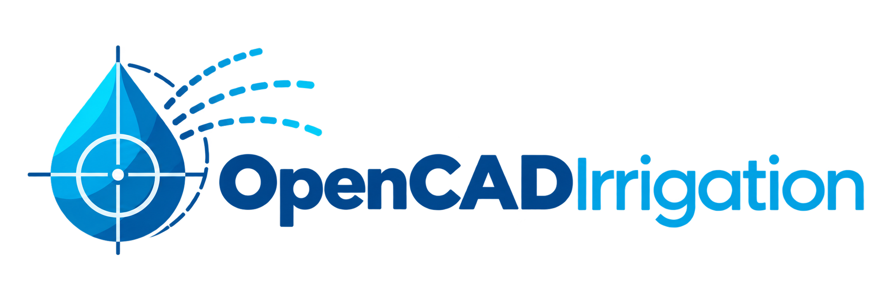
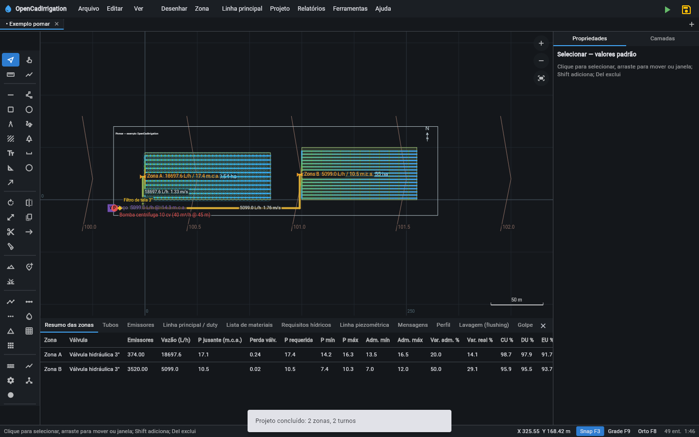

<a href="https://opencadirrigation.com">opencadirrigation.com</a> · <a href="https://opencadirrigation.com/pt/">Português</a> · <a href="https://opencadirrigation.com/es/">Español</a> · <a href="LICENSE.md">MIT licence</a>

<strong>English</strong> · <a href="README.pt-BR.md">Português</a>

# OpenCADIrrigation

Open-source CAD, written in Flutter/Dart, for the design of pressurised irrigation systems: drawing, hydraulic network,
pipe sizing, reports and plotting, right in the browser, with no installation, no server and no sign-up, plus an
optional AI assistant (Claude or GPT, with your own key) that draws and designs the project with you. Projects stay on
your computer. Released under the [MIT licence](LICENSE.md).

## Start in five minutes

1. Open [opencadirrigation.com](https://opencadirrigation.com) and press **Open the app** (or open an example or the
   tutorial straight from the page). It runs in Chrome, Edge, Firefox and Safari, on desktop, tablet and phone, and
   installs as an app that starts without a network after the first visit.
2. Say where the area is (an address or coordinates) and whether to design with the AI assistant, or open a ready
   example: Help → Welcome and example gallery, with the **interactive tutorial**.
3. Draw the area and the network, or let the generators or the assistant do it; press **F5** to design.
4. Read the results in the **Reports** panel (F2) and export PDF sheets, DXF, DWG, Excel and more; save the project
   with **Ctrl+S** (`.oci.json`).

More in [the five-minute start](docs/manual/getting-started.md).

## What it is

A single application covering the whole cycle of a pressurised irrigation design:

- **Optional AI agent**: Claude (Anthropic) or GPT (OpenAI), with your own API key, works on the
  open project with the program's own tools: it answers questions, asks what is missing, plans,
  draws, designs, checks and reports, with your approval and an undo for every answer
  ([AI assistant](docs/manual/ai-assistant.md)); nothing is sent until you press Send.
- **2D CAD drawing** with layers, snaps, typed coordinates, dimensions, hatches, symbols, user
  blocks, review comments and revision clouds, and typed command aliases (L, PL, C, ZE…) as in desktop
  CAD programs.
- **Hydraulic network** drawn on top of the CAD: water supplies, pumps (fixed or variable speed),
  mainline, zone valves, laterals with emitters, drip tapes and driplines, filters, pressure
  regulators, pressure-sustaining valves, hydrants with flow limiters, meters, junctions,
  valve-in-head sprinklers, centre pivots and linear moves.
- **Hydraulic engine** in pure Dart: Hazen-Williams, Darcy-Weisbach, Scobey or Manning friction,
  minor losses (a share of the length or the bends and tees of the drawing), emitters
  `q = k·H^x`, network solver by the Global Gradient Algorithm (the one used by EPANET), pumps,
  pressure-reducing, pressure-sustaining and flow-control valves, tape flushing, water hammer by
  the method of characteristics and a 24-hour extended-period simulation.
- **Automatic sizing** of laterals, submains and mainline by linear programming (annualised pipe
  cost plus energy, emitter pressure window, pipe pressure class at the water temperature,
  telescoping) or by the classic maximum-velocity method.
- **Automatic design**: landscape head layout with zoning and routing of pipes and valves, field
  subdivision into blocks, orchard drip rings, sports and golf templates, pivot fit, and
  vegetation detected in aerial imagery.
- **Agronomy and operation**: site climate (downloaded or typed), FAO-56 crops with growth stages,
  soils, effective rain and leaching, requirement tables, valve wiring (conventional or two-wire),
  time-of-use tariffs, on-demand networks, fertigation, mechanised machines and surface
  irrigation.
- **Terrain**: contour lines, spot heights, breaklines, digital terrain model by triangulation,
  LAS point clouds and LandXML surfaces, elevation downloaded from the internet for a coordinate,
  slope maps, profiles and hydraulic grade line.
- **Outputs**: reports of zones, pipes, emitters, system flows, bill of materials with fittings,
  water requirements and controller programme; PDF sheets in every interface script (sets per
  zone, construction details, charts); a commercial quote; DXF and DWG (R2000, native
  entities), SVG, PNG, KML, KMZ, GeoJSON, shapefile, GPX, LandXML, IFC 4, EPANET, Excel, CSV.
- **Open manufacturer catalogues** in JSON, loadable by file or URL.
- **Command line and engine API**: `bin/oci.dart` designs, checks and exports projects without a
  browser; `lib/core/api.dart` gives the whole engine in one import ([docs/API.md](docs/API.md)).

## Who it is for

Agricultural and landscape irrigation designers, agronomists, engineers, dealers, teachers and
students. The interactive tutorial and the example gallery let you start without reading a manual.

## Principles

| Principle | What it means in practice |
|---|---|
| Open | Code, project format (`.oci.json`), catalogues (`.oci.cat`) and examples are readable files, documented in this repository. |
| In the browser | Chrome, Edge, Firefox and Safari, on desktop, tablet and phone; installable as a PWA that starts without a network after the first visit. It also builds for desktop (macOS, Windows, Linux). Native Android and iOS builds are not made: on phones and tablets use the web app. |
| No server | There is no server behind the app and no account. Projects live in the browser and in local files. The internet is used for what you ask for (base maps, online elevation and climate, address search, catalogues by URL, and the optional AI assistant, the one feature that sends project data, to the AI provider you choose) and, on the site's pages and only if you accept them, for the visit statistics; see [Storage, privacy and network access](docs/manual/privacy-and-network.md). |
| Transparent engine | Every formula is documented in the code and in the [technical study](docs/TECHNICAL_STUDY.md), with tests comparing it to reference values. |
| 20 languages | Interface in Portuguese, English, Spanish, Chinese, Hindi, Arabic, French, Bengali, Russian, Urdu, Indonesian, German, Japanese, Marathi, Vietnamese, Telugu, Hausa, Turkish, Punjabi and Swahili; the app opens in the system language, and Arabic and Urdu lay the interface out right to left. |

## Manual

The manual is in [docs/manual/](docs/manual/README.md) (Portuguese: [docs/manual/pt-BR/](docs/manual/pt-BR/README.md)):

- [Five-minute start](docs/manual/getting-started.md): open the app, the example gallery, the URL parameters
- [Design workflow](docs/manual/workflow.md): from the area to the reports, step by step
- [Interface](docs/manual/interface.md): layout, menus, compact layout and keyboard shortcuts
- [Drawing and editing](docs/manual/drawing.md): entities, snaps, selection, transformations, blocks, layers
- [Hydraulic network](docs/manual/hydraulic-network.md): hydraulic items, connection rules, generators, automatic design
- [Component catalogue](docs/manual/catalogue.md): pipes, emitters, valves, pumps, prices and manufacturer packs
- [Terrain](docs/manual/terrain.md): contours, spot heights, the terrain model, online elevation
- [Calculation and sizing](docs/manual/calculation.md): parameters, calculation steps, design check and assistant, analyses
- [AI assistant](docs/manual/ai-assistant.md): what the optional assistant does, what it sends and how it is controlled
- [Reports, plotting and export](docs/manual/reports-and-export.md): reports panel, PDF sheets, quote, exports
- [File formats](docs/manual/file-formats.md): the project file and every import and export format
- [Storage, privacy and network access](docs/manual/privacy-and-network.md): what stays in the browser, what goes out and to whom
- [Languages and site](docs/manual/languages-and-site.md): the 20 languages, the site, the offline start and the hosting
- [Code architecture](docs/manual/architecture.md): the source tree and the design decisions
- [Development and tests](docs/manual/development.md): commands, how to extend, what every test guarantees
- [Known limitations and roadmap](docs/manual/limitations.md): what the app does not do yet
- [References](docs/manual/references.md): standards, books and papers behind the engine
- [Licence, third-party components and data](docs/manual/licence.md): MIT licence, the components and the data sources

The technical study behind the engine is [docs/TECHNICAL_STUDY.md](docs/TECHNICAL_STUDY.md) (Portuguese:
[docs/PESQUISA.pt-BR.md](docs/PESQUISA.pt-BR.md)); the engine API is [docs/API.md](docs/API.md)
([docs/API.pt-BR.md](docs/API.pt-BR.md)); what the AI assistant reaches is [docs/AI_TOOLS.md](docs/AI_TOOLS.md).

## Contributing, security and licence

- [CONTRIBUTING.md](CONTRIBUTING.md): how to propose changes, catalogues, examples and translations, the editorial
  rule and the release checklist; [CODE_OF_CONDUCT.md](CODE_OF_CONDUCT.md).
- [SECURITY.md](SECURITY.md): how to report a vulnerability privately.
- [CHANGELOG.md](CHANGELOG.md): what changed in each version; [CITATION.cff](CITATION.cff) to cite it.
- The app is a design aid: a qualified professional checks and signs a design made with it (terms of use at
  <https://opencadirrigation.com/terms/>, privacy policy at <https://opencadirrigation.com/privacy/>).
- [MIT licence](LICENSE.md); third-party components and data in [the licence chapter](docs/manual/licence.md).
