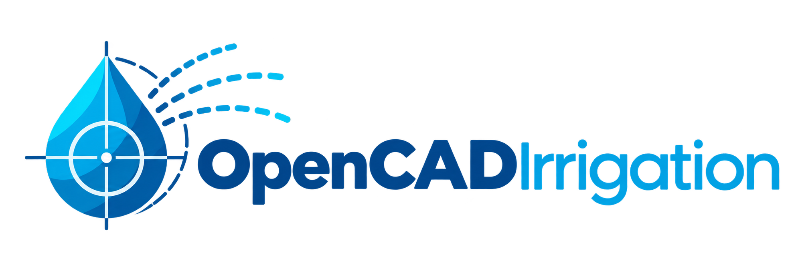
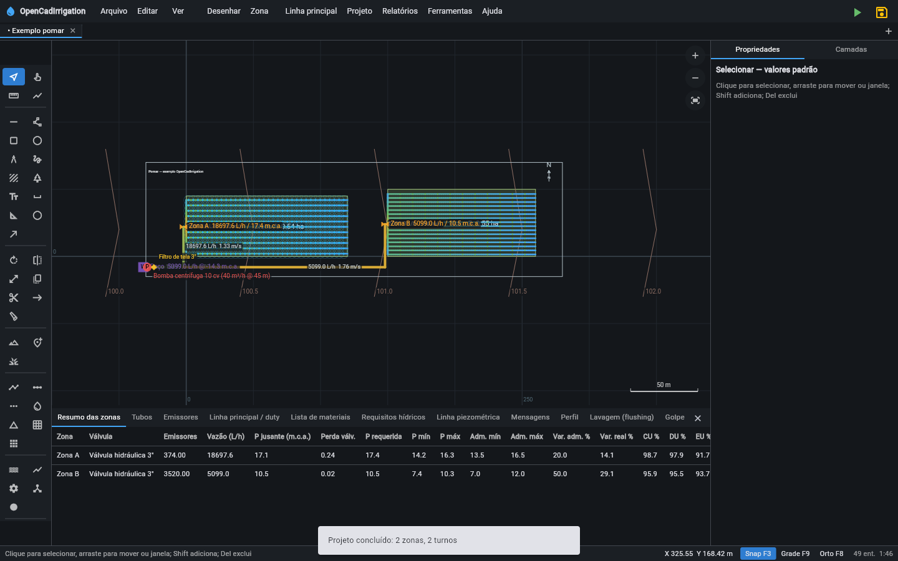

<a href="https://opencadirrigation.com/pt/">opencadirrigation.com/pt</a> · <a href="https://opencadirrigation.com">English</a> · <a href="https://opencadirrigation.com/es/">Español</a> · <a href="LICENSE.md">Licença MIT</a>

<a href="README.md">English</a> · <strong>Português</strong>

# OpenCADIrrigation

CAD de código aberto, escrito em Flutter/Dart, para projeto de sistemas de irrigação pressurizada: desenho, rede
hidráulica, dimensionamento de tubulações, relatórios e plotagem, direto no navegador, sem instalação, sem servidor e
sem cadastro, mais um assistente de IA opcional (Claude, GPT, Gemini, Grok, Muse ou os modelos da OpenRouter, com a
sua própria chave) que desenha e projeta com você. Os projetos ficam no seu computador. Publicado sob a [licença MIT](LICENSE.md). Esta é a tradução do
[README em inglês](README.md), que é o canônico.

## Comece em cinco minutos

1. Abra [opencadirrigation.com/pt](https://opencadirrigation.com/pt/) e clique em **Abrir o app** (ou abra um exemplo
   ou o tutorial direto da página). Ele roda no Chrome, Edge, Firefox e Safari, no computador, no tablet e no
   celular, e se instala como aplicativo que abre sem rede depois da primeira visita.
2. Diga onde fica a área (um endereço ou coordenadas) e se o projeto será feito com o assistente de IA, ou abra um
   exemplo pronto: Ajuda → Boas-vindas e galeria de exemplos, com o **tutorial interativo** (90 passos em capítulos).
   Ctrl+K acha qualquer menu, comando ou ajuste, e F1 abre o manual.
3. Desenhe a área e a rede, ou deixe os geradores ou o assistente fazerem isso; pressione **F5** para projetar.
4. Leia os resultados no painel **Relatórios** (F2) e exporte pranchas em PDF, DXF, DWG, Excel e mais; salve o
   projeto com **Ctrl+S** (`.oci.json`).

Mais em [início em cinco minutos](docs/manual/pt-BR/getting-started.md).

## O que é

Um único aplicativo que cobre o ciclo completo de um projeto de irrigação pressurizada:

- **Agente de IA opcional**: um modelo da Anthropic (Claude), da OpenAI (GPT), do Google (Gemini),
  da xAI (Grok), da Meta (Muse) ou da OpenRouter (centenas de modelos com uma só chave, alguns
  gratuitos), com a sua própria chave de API, trabalha no projeto aberto com as ferramentas do
  próprio programa: responde perguntas, pergunta o que falta, planeja, desenha, projeta, verifica e
  escreve o memorial, com a sua aprovação e um desfazer para cada resposta, e o modelo de outra
  empresa pode dar uma segunda opinião sobre uma resposta
  ([Assistente de IA](docs/manual/pt-BR/ai-assistant.md)); nada é enviado antes de você clicar em
  Enviar.
- **Desenho CAD 2D** com camadas e estados de camadas, snaps um a um, coordenadas digitadas e de
  campo (UTM, latitude e longitude, azimutes e rumos), cotas com estilo do projeto, hachuras, símbolos,
  blocos do usuário e referências de bloco com atributos, comentários de revisão, nuvens de revisão e
  fotos de campo, comparação de duas cópias, e aliases de comando digitados (L, PL, C, ZE…) como nos
  programas de CAD.
- **Rede hidráulica** desenhada sobre o CAD: fontes de água (também de um reservatório ou açude),
  bombas (de rotação fixa ou com inversor, ou uma estação de bombeamento em paralelo ou em série com
  reservas), linha principal, válvulas de zona com piloto redutor ou sustentador, laterais com
  emissores, fitas e tubos gotejadores, filtros, reguladores de pressão, válvulas sustentadoras de
  pressão, hidrantes com limitador de vazão, hidrômetros, junções e vasos de ar, aspersores com
  válvula (valve-in-head), pivôs centrais e lineares, faixas de carretel e sulcos; áreas irrigadas
  com ilhas.
- **Motor hidráulico** em Dart puro: perda de carga por Hazen-Williams, Darcy-Weisbach, Scobey ou
  Manning, perdas localizadas (fração do comprimento ou as curvas e tês do desenho), emissores
  `q = k·H^x`, solver de rede pelo Global Gradient Algorithm (o mesmo do EPANET), bombas, válvulas
  redutoras, sustentadoras e controladoras de vazão, lavagem de fitas, golpe de aríete pelo método
  das características, simulação de período estendido de 24 horas com o nível dos reservatórios, a
  operação real dos setores pela pressão que a linha principal entrega e o projeto envelhecido e
  entupido.
- **Dimensionamento automático** de laterais, linhas de derivação e linha principal por programação linear
  (custo anualizado de tubos + energia, janela de pressão dos emissores, classe de pressão dos tubos
  na temperatura da água e com o golpe de aríete, balanço de energia de cada anel, telescopagem) ou
  pelo método clássico de velocidade máxima.
- **Projeto automático**: layout de aspersores em paisagismo com zoneamento e traçado de tubos e
  válvulas, divisão de talhões em blocos com o comprimento máximo da lateral calculado, anéis de
  gotejamento em pomares, modelos de campos esportivos e golfe, ajuste de pivô ao talhão e vários
  pivôs numa propriedade, talhões contornados na imagem de satélite, vegetação detectada em imagem
  aérea, a direção, o espaçamento e o número das fileiras de pomares, cafezais, vinhedos e citros
  lidos na imagem de satélite para as laterais as seguirem, e correções e otimização revistas item a
  item.
- **Agronomia e operação**: clima do local (baixado, digitado ou de arquivos de estação do INMET),
  culturas da FAO-56 com fases de desenvolvimento e culturas do usuário, solos, chuva efetiva e
  lixiviação, tabelas de necessidade, balanço hídrico diário do solo com déficit regulado, o programa
  do controlador com janela de rega e ciclo e pausa, escoamento potencial, fertirrigação por
  estágio, avaliações de uniformidade no campo, fiação das válvulas (convencional ou dois fios),
  tarifa horária, redes sob demanda, máquinas mecanizadas e irrigação por superfície. O programa de
  rega roda na planta (zonas irrigando, tubos por vazão e velocidade, bombas, nível do reservatório)
  e é exportado como GIF animado e como calendário para o celular (.ics); a previsão de irrigação
  transforma a previsão do tempo do local (dados abertos do MET Norway) no tempo de funcionamento de
  cada setor nos próximos dias; o risco climático confere o projeto contra quarenta anos reais de
  clima diário da NASA POWER (necessidade e demanda de pico por probabilidade, confiabilidade,
  veranicos, tendência).
- **Energia e água**: elétrica da casa de bombas (motores, partidas, alimentadores, curto-circuito,
  transformador), bombeamento solar no projeto, qualidade da água com os seus filtros, cloração e
  ácido.
- **Terreno**: curvas de nível, cotas, linhas de quebra, modelo digital por triangulação, nuvens
  de pontos LAS e superfícies LandXML, elevação baixada da internet a partir de uma coordenada,
  mapas de declividade, perfis e linha piezométrica.
- **Saídas**: relatórios de zonas, tubos, emissores, turnos, lista de materiais com conexões,
  requisitos hídricos e programa do controlador, cada tabela com as normas dos seus critérios;
  pranchas em PDF em todas as escritas da interface (conjuntos por zona, detalhes construtivos,
  gráficos, quadrícula de coordenadas, folhas de declividade e de exposição, carimbo profissional com
  o responsável técnico, qualquer tamanho de papel, PDF/A-2b); pacotes de documentos por leitor e
  documentos técnicos (quadro de outorga, memorial, plano de operação e manutenção, orçamento por
  composições, custo do ciclo de vida); orçamento comercial; DXF e DWG (R2000, entidades nativas,
  dados hidráulicos), SVG, PNG, KML, KMZ, GeoJSON, shapefile, GPX, LandXML, IFC 4, EPANET, pontos
  para locação, Excel, CSV; e um **boletim de qualidade do projeto** que dá ao projeto calculado um
  conceito de A a E em sete categorias, cada indicador com o alvo e a norma de onde ele vem, e diz o
  que melhorar primeiro.
- **Catálogos abertos** em JSON, carregáveis por arquivo ou URL: pacotes de fabricantes e tubos
  genéricos por norma (ISO 1452, EN 12201, IS 4985, IS 4984, ASTM); curvas de bomba, de emissor e
  perfis de aspersor digitalizados de uma imagem de gráfico de catálogo.
- **Linha de comando e API do motor**: `bin/oci.dart` importa desenhos, começa, altera, projeta,
  verifica e exporta projetos sem navegador, um ou vários de uma vez; `lib/core/api.dart` traz o motor
  inteiro numa importação, também como pacote Dart sem Flutter ([docs/API.pt-BR.md](docs/API.pt-BR.md)).
- **Servidor MCP**: `bin/oci.dart mcp --root <pasta>` deixa qualquer aplicativo de IA que fale o Model
  Context Protocol projetar, verificar e exportar projetos com o motor no seu computador, restrito a
  uma pasta ([docs/MCP.pt-BR.md](docs/MCP.pt-BR.md)).

## Para quem

Projetistas de irrigação agrícola e paisagística, agrônomos, engenheiros, revendas, professores e
estudantes. O tutorial interativo (com trilhas rápidas de gotejamento, paisagismo e pivô) e a galeria
de exemplos permitem começar sem ler manual.

## Princípios

| Princípio | O que significa na prática |
|---|---|
| Aberto | Código, formato de projeto (`.oci.json`), catálogos (`.oci.cat`) e exemplos são arquivos legíveis, documentados neste repositório. |
| No navegador | Chrome, Edge, Firefox e Safari, em computador, tablet e celular; instalável como PWA, que abre sem rede depois da primeira visita. Também compila para desktop (macOS, Windows, Linux). Não há builds nativos para Android e iOS: no celular e no tablet use o app web. |
| Sem servidor | Não há servidor por trás do app nem cadastro. Projetos ficam no navegador e em arquivos locais. A internet é usada para o que você pede (mapas base, elevação e clima online, a previsão do tempo, busca de endereços, catálogos por URL e o assistente de IA opcional, o único recurso que envia dados do projeto, para o provedor de IA que você escolher) e, nas páginas do site e no app, para as estatísticas de visita (Google Analytics, com os seus cookies; Preferências de cookies, no rodapé das páginas, as desliga); veja a [Armazenamento, privacidade e rede](docs/manual/pt-BR/privacy-and-network.md). |
| Motor transparente | Cada fórmula está documentada no código e no [estudo técnico](docs/PESQUISA.pt-BR.md), com testes que a comparam a valores de referência. |
| 20 idiomas | Interface em português, inglês, espanhol, chinês, hindi, árabe, francês, bengali, russo, urdu, indonésio, alemão, japonês, marati, vietnamita, télugo, hauçá, turco, panjabi e suaíli; o app abre no idioma do sistema, e em árabe e urdu a interface é da direita para a esquerda. |

## Manual

O manual está em [docs/manual/pt-BR/](docs/manual/pt-BR/README.md) (inglês, o canônico: [docs/manual/](docs/manual/README.md)), e no
site como o [guia do usuário](https://opencadirrigation.com/pt/manual/) ([em inglês](https://opencadirrigation.com/manual/)):

- [Início em cinco minutos](docs/manual/pt-BR/getting-started.md): abrir o app, a galeria de exemplos, os parâmetros de endereço
- [Fluxo de projeto](docs/manual/pt-BR/workflow.md): da área aos relatórios, passo a passo
- [Interface](docs/manual/pt-BR/interface.md): layout, menus, layout compacto e atalhos de teclado
- [Desenho e edição](docs/manual/pt-BR/drawing.md): entidades, snaps, seleção, transformações, blocos, camadas
- [Rede hidráulica](docs/manual/pt-BR/hydraulic-network.md): itens hidráulicos, regras de conexão, geradores, projeto automático, fileiras da imagem
- [Catálogo de componentes](docs/manual/pt-BR/catalogue.md): tubos, emissores, válvulas, bombas, preços e pacotes de fabricantes
- [Terreno](docs/manual/pt-BR/terrain.md): curvas de nível, cotas, modelo do terreno, elevação online
- [Cálculo e dimensionamento](docs/manual/pt-BR/calculation.md): parâmetros, etapas do cálculo, verificação e assistente de projeto, boletim de qualidade, análises
- [Agronomia e manejo da irrigação](docs/manual/pt-BR/agronomy.md): balanço hídrico diário, programa de rega e o seu reprodutor, previsão de irrigação, risco climático, escoamento, fertirrigação, uniformidade no campo
- [Energia, água e máquinas](docs/manual/pt-BR/power-water-machines.md): elétrica da casa de bombas, bombeamento solar, qualidade da água, dois fios, vários pivôs
- [Assistente de IA](docs/manual/pt-BR/ai-assistant.md): o que o assistente opcional faz, o que ele envia e como é controlado
- [Relatórios, plotagem e exportação](docs/manual/pt-BR/reports-and-export.md): painel de relatórios, pranchas em PDF, orçamento, exportações
- [Carimbo e documentos técnicos](docs/manual/pt-BR/technical-documents.md): carimbo profissional, pacotes de documentos, quadro de outorga, memorial, orçamento
- [Formatos de arquivo](docs/manual/pt-BR/file-formats.md): o arquivo de projeto e cada formato de importação e exportação
- [Armazenamento, privacidade e rede](docs/manual/pt-BR/privacy-and-network.md): o que fica no navegador, o que sai e para quem
- [Idiomas e site](docs/manual/pt-BR/languages-and-site.md): os 20 idiomas, o site, a abertura sem rede e a hospedagem
- [Arquitetura do código](docs/manual/pt-BR/architecture.md): a árvore de código e as decisões de projeto
- [Desenvolvimento e testes](docs/manual/pt-BR/development.md): comandos, como estender, o que cada teste garante
- [Limitações conhecidas e próximos passos](docs/manual/pt-BR/limitations.md): o que o app ainda não faz
- [Referências](docs/manual/pt-BR/references.md): normas, livros e artigos por trás do motor
- [Licença, componentes e dados de terceiros](docs/manual/pt-BR/licence.md): licença MIT, os componentes e as fontes de dados

O estudo técnico por trás do motor é o [docs/PESQUISA.pt-BR.md](docs/PESQUISA.pt-BR.md) (inglês:
[docs/TECHNICAL_STUDY.md](docs/TECHNICAL_STUDY.md)); a API do motor é o [docs/API.pt-BR.md](docs/API.pt-BR.md)
([docs/API.md](docs/API.md)); o servidor MCP é o [docs/MCP.pt-BR.md](docs/MCP.pt-BR.md); o que o assistente de IA
alcança está em [docs/AI_TOOLS.md](docs/AI_TOOLS.md).

## Contribuição, segurança e licença

- [CONTRIBUTING.md](CONTRIBUTING.md): como propor mudanças, catálogos, exemplos e traduções, a regra editorial e o
  checklist de lançamento; [CODE_OF_CONDUCT.md](CODE_OF_CONDUCT.md).
- [SECURITY.md](SECURITY.md): como relatar uma vulnerabilidade em particular.
- [CHANGELOG.pt-BR.md](CHANGELOG.pt-BR.md): o que mudou em cada versão; [CITATION.cff](CITATION.cff) para citá-lo.
- O app é uma ferramenta de apoio: um profissional habilitado confere e assina o projeto feito com ele (termos de uso
  em <https://opencadirrigation.com/pt/terms/>, política de privacidade em <https://opencadirrigation.com/pt/privacy/>).
- [Licença MIT](LICENSE.md); componentes e dados de terceiros no [capítulo da licença](docs/manual/pt-BR/licence.md).
